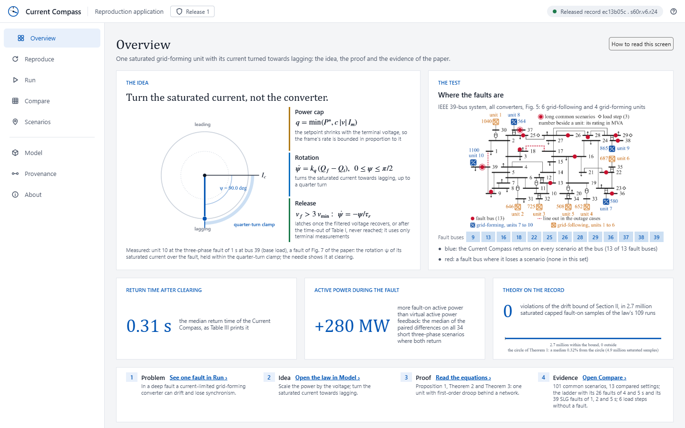

# current-compass-ieee39

This repository holds the MATLAB application of the paper "Current Compass: A Local Control Law for Synchronisation Stability of Grid-Forming Converters at the Current Limit" by A. H. Poursaeed, F. Namdari, S. Shen and P. A. Crossley, with its released data, the campaign table of the paper's runs and a user guide.

With the application you can:

- see every figure and every table of the paper, and every one of the 608 numbers that the paper prints, each at
  its place in the paper;
- see the outcome of every one of the paper's 7,218 simulation runs, with its set, law, setting, fault, load and
  network state;
- put the Current Compass and the 13 compared settings side by side on the scenarios you choose: the 101 common
  scenarios, the ladder of fault locations, the load steps, or the parts of the law;
- follow the decisive fault of Fig. 7 (a three-phase fault of 1 s at bus 39) in the recorded traces of its seven
  runs: the angles, the terminal voltage, the current against its limit and the rotation of the current, with one
  time cursor for all of them;
- see, in pictures of the model as Simulink prints it, how the Current Compass and every compared law are
  implemented in the controller of a grid-forming unit;
- make every number file of the application again from the released files, compare it with the shipped one, and
  run the application's tests.



*The first screen of the application (Overview).*

**New here? Start with the user guide:** [How to use the application (PDF)](guide/How_to_use_the_application.pdf).
Its first page gives the steps from the download to the first results. Then it shows every screen and every button
with a picture, explains how the paper judges a run, and describes every set of runs on its own page.

## Start in four steps

1. Download this repository. On this page, click the green **Code** button, then **Download ZIP**, and unzip the
   file. (With git: `git clone https://github.com/AH-Poursaeed/current-compass-ieee39.git`.)
2. Open MATLAB. The application's tests ran on MATLAB R2026a. In MATLAB, go to the folder `app` of the repository.
3. Type `ccapp` and press Enter. The window opens on the Overview screen (the picture above).
4. Look first at four places: the **Overview** (the idea, the test system and three results); **Reproduce**, then
   the tile of a table (for example Table II, with the losses of every law); **Compare** (every law on the 101
   common scenarios; click a cell to open its run); and the traces of the decisive fault (on the Overview, click
   **See one fault in Run**).

Every screen has a button **How to read this screen** at the top right. It explains what each number means, where
the paper prints it and how the paper judges a run.

You can also open the application on one screen:

```matlab
ccapp(Screen="reproduce")      % the paper's figures, tables and numbers
ccapp(Screen="run")            % the list of the paper's runs
```

`help ccapp` lists the other options.

## What is behind the paper

- **7,218 simulation runs** of one EMT model of the IEEE 39-bus system, built in Simscape Electrical. Every
  source is a converter: six grid-following and four grid-forming units.
- **278 GB of simulation records**, one MATLAB file per run (16 to 147 MB each). The application carries what the
  paper reads from them: the outcome of every run, all 608 numbers that the paper prints, and the traces of the 7
  runs of Fig. 7.
- **The laws:** the Current Compass, its six parts, and 13 compared settings of seven published laws and two
  baselines. All of them are compared on the same faults.
- **The test:** a run loses synchronism if the angle of a grid-forming unit, measured against the mean of the four,
  passes half a turn after the fault is cleared (the full rule, with its test at the end of the record, is in
  Section IV of the paper and in the user guide). A law is counted on a scenario where its run without a fault is
  steady.

The runs belong to 12 sets. A run that two sets share ran once, so the numbers add up to more than 7,218.

| Set | Runs | What it tests |
|---|---:|---|
| common scenarios | 2,276 | every law on the same 101 faults at 13 buses, at two loads and four network states |
| shortened runs | 918 | 27 of the common faults shortened to 100 and 150 ms |
| ladder 0.01 pu | 857 | three-phase faults of 0.3, 1 and 2 s at all 13 buses |
| ladder 0.001 pu | 741 | deeper three-phase faults of 0.15, 0.3 and 1 s at all 13 buses |
| faults of 4 and 5 s | 494 | long three-phase faults at all 13 buses |
| single-phase ladder | 774 | single-line-to-ground faults of 1, 2 and 5 s at all 13 buses |
| load steps | 114 | six load steps without a fault |
| Table IV | 1,082 | one setting changed at a time (current limit, gains, filters, droop) on 18 scenarios |
| reruns | 11 | numerical checks of the Current Compass (tighter tolerance, halved steps) |
| theory checks | 8 | runs that check the theory in the 39-bus system |
| module search | 108 | the own synchronisation modules of one compared law, without a fault |
| fault-free row | 275 | the runs without a fault that decide where each law is eligible |

The Run screen of the application lists every one of these runs with its outcome, and the user guide explains each
set on its own page.

## The screens

| Screen | What you find there |
|---|---|
| Overview | the idea of the Current Compass, the test network and three results of the paper |
| Reproduce | the figures and tables of the paper, every number that the paper prints with its place, and a button that makes the numbers again from the released files |
| Run | every run of the paper with its outcome; filters by set, by law and by outcome; the recorded traces of the decisive fault of Fig. 7 |
| Compare | the Current Compass and every compared setting on the same scenarios; a click on a cell opens its run |
| Scenarios | the common scenarios, grouped by the bus of the fault |
| Model | the test system, the law with its equations and constants, and pictures of the model: the network, one converter, its controller, and how the Current Compass and each compared law are implemented |
| Provenance | where each number on the screens comes from in the released record |
| About | how to cite the work, its licence, its authors and what the application needs |

## How the application works

When it starts, the application reads the folder `app/data` and draws every screen from it: the released record
(every number that the paper prints and every number that the data step reads), the outcome of every run (one row
for each row of the campaign table) and the recorded traces of the seven runs of Fig. 7 (`app/data/runs`). Every
number on a screen is read from these files; no number is typed in the program.

## Check the numbers yourself

Every number file of the application can be made again from the released files. On the Reproduce screen, press the
button "Regenerate the application's data". Or, from the root folder of the repository, with Python 3 (the standard
library is enough):

```
python app/tools/make_app_data.py --into regen
```

It writes the new files into `regen/data` and prints, for each number file, whether it is equal to the shipped
file, byte for byte (by sha256). `regen/data/REGEN.json` holds the same result.

## What is in this repository

- `app/`: the application (MATLAB). Its data are in `app/data/` and its tests are in `app/tests/`.
- `app/data/record/`: the released record. It holds every number that the data step reads and every number that
  the paper prints.
- `artifacts/campaign/`: the campaign table of the paper's runs. It is a text file with one row for each run (the
  law and its setting, the fault, the load and the network state), and it has its own README.
- `src/frt/readers/`: the Python readers. They read the outcome of a run from its simulation record, the MATLAB
  v7.3 file that the model writes for each run. They need Python 3 with NumPy and h5py:
  `python -m pip install -r requirements.txt`.
- `guide/`: the user guide (PDF) and the picture above.
- `LICENSE` (MIT), `CITATION.cff`, `app/THIRD_PARTY_NOTICES.txt`, `requirements.txt` and `MANIFEST.sha256` (every
  other file of this repository with its SHA-256).

## Tests

In MATLAB, from the folder `app`:

```matlab
runtests('tests/tCore.m')      % the data against the released record, the tables, the sets, static checks
runtests('tests/tUI.m')        % the window: every screen built, every button pressed, the tables and notes as the paper prints them
```

## Credit

The test system and its control design are the published system of X. Wang and X. Chen (see
`app/THIRD_PARTY_NOTICES.txt` and the About screen of the application).

## How to cite

See `CITATION.cff`.
